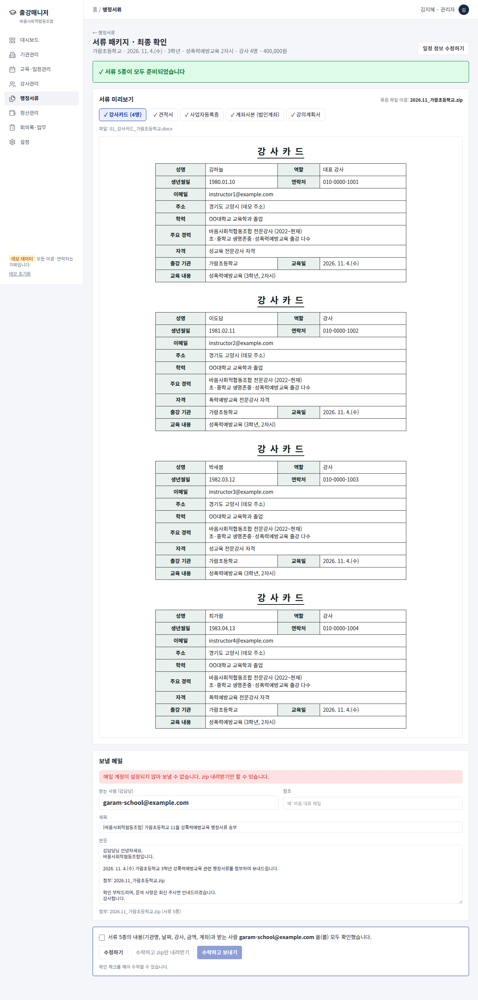
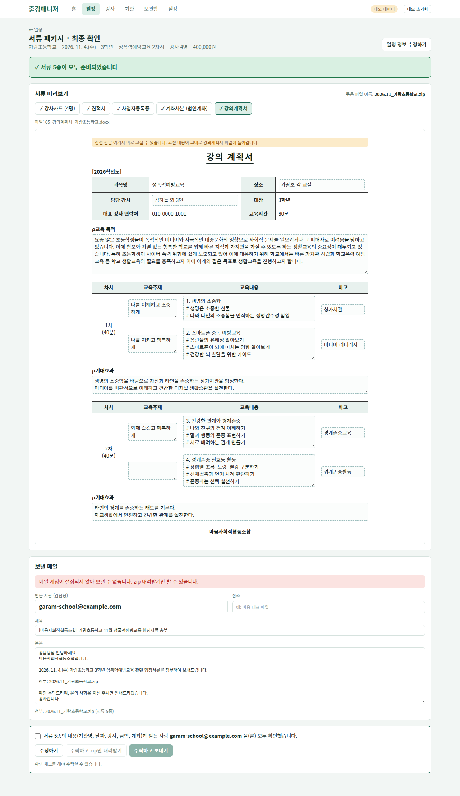

# 출강매니저

바움사회적협동조합의 출강 일정을 관리하고, 강의의뢰가 들어오면 **행정서류 5종을 만들어 최종 확인한 뒤 `yyyy.mm_기관명.zip`으로 묶어 기관 담당자에게 메일로 보내는** 웹앱입니다.

- 데모: (배포 후 주소 기입)
- 2026 KMU AI에이전트실무 2분반 U2026033 김지혜 · 중간 MVP 구현물

> 저장소와 데모의 강사·학교·계좌·사업자번호는 **모두 지어낸 데이터**입니다. 실제 업무 데이터는 저장소에 넣지 않습니다.

## 문제

강사 14명이 여러 학교와 기관에 출강하는 교육 협동조합에서는, 강의가 확정될 때마다 기관이 같은 행정서류를 요청합니다.

| 서류 | 내용 |
|---|---|
| 강사카드 | 배정된 강사 수만큼 |
| 견적서 | 강사 1인 1차시 단가 × 차시 × 인원 |
| 사업자등록증 | 매번 같은 파일 |
| 계좌사본 | 보통 법인계좌, 기관이 요청하면 강사 개인계좌 |
| 강의계획서 | 바움 양식에 과목·대상·차시를 맞춰 작성 |

담당자는 매번 이 서류들을 찾고, 고치고, 모으고, 메일로 보냅니다. 같은 정보를 반복 입력하고, 개인계좌 요청 건에서 계좌사본을 잘못 넣거나 서류를 빠뜨리기 쉽고, 파일 이름이 제각각이라 나중에 찾기 어렵습니다.

## 하는 일

1. **일정** – 강의의뢰를 등록합니다 (기관, 날짜, 대상, 과목, 차시, 강사, 단가, 법인/개인계좌). 목록과 달력으로 봅니다.
2. **서류 패키지 · 최종 확인** – 일정 하나에서 서류 5종을 자동으로 채우고 미리 보여 줍니다.
   - 빠진 항목(단가, 담당자 이메일, 개인 통장사본 등)은 경고로 표시하고, 해결하기 전에는 수락할 수 없습니다.
   - 강의계획서는 이 화면에서 바로 고칠 수 있습니다.
   - 받는 사람, 제목, 본문을 확인하고 "모두 확인했습니다"에 체크해야 수락 버튼이 열립니다.
3. **수락하고 보내기** – 서류 5종을 `yyyy.mm_기관명.zip`으로 묶어 내 컴퓨터에 저장하고, 기관 담당자에게 메일로 보냅니다. 일정에 발송 이력이 남습니다.
4. **보관함** – 사업자등록증, 법인 통장사본, 강사별 개인 통장사본, 과목별 강의계획서 내용을 한 번 올려 두고 계속 씁니다.
5. **설정** – 메일 제목·본문 틀, 참조 메일, 공급자 정보, 법인 계좌를 화면에서 바꿉니다. 백업 파일로 내려받고 복원할 수 있습니다.

| 서류 패키지 최종 확인 | 강의계획서 (바로 수정) |
|---|---|
|  |  |

## 실행 방법

필요한 것: Node.js 20 이상

```bash
git clone https://github.com/wisdommhjj-spec/lecture-manager.git
cd lecture-manager
npm install
cp .env.example .env.local   # 메일을 보내려면 값 채우기 (아래 참고)
npm run dev
```

브라우저에서 http://localhost:3000 을 엽니다. 처음 열면 데모 데이터가 들어 있습니다. 오른쪽 위 **데모 초기화**를 누르면 처음 상태로 돌아갑니다.

### 메일 발송 설정

메일 없이도 서류 확인과 zip 내려받기는 됩니다. 메일까지 보내려면 `.env.local`에 다음 값을 채웁니다.

| 변수 | 설명 |
|---|---|
| `GMAIL_USER` | 보내는 Gmail 주소 |
| `GMAIL_APP_PASSWORD` | 그 계정의 앱 비밀번호 (구글 계정 → 보안 → 2단계 인증 → 앱 비밀번호) |
| `MAIL_TEST_RECIPIENT` | 값이 있으면 **테스트 모드**: 받는 사람과 상관없이 이 주소로만 보냄 |
| `SEND_PASSCODE` | 값이 있으면 발송할 때 이 암호를 입력해야 함 (공개 데모 주소 악용 방지) |

**메일 계정 바꾸기** (예: 개인 메일 → 바움 대표 메일): 배포한 곳(Vercel → Settings → Environment Variables)에서 `GMAIL_USER`와 `GMAIL_APP_PASSWORD`를 새 계정 값으로 바꾸고 다시 배포합니다. 코드는 고치지 않습니다.

### 배포 (Vercel)

1. Vercel에서 이 저장소를 Import 합니다.
2. Environment Variables에 위 값을 넣습니다. 데모용 배포에는 `MAIL_TEST_RECIPIENT`와 `SEND_PASSCODE`를 꼭 넣습니다.
3. Deploy. 이후 `main`에 올리면 자동으로 다시 배포됩니다.

## 구조

```
src/
  app/
    page.tsx              홈 (서류를 보내야 하는 출강)
    schedule/             일정 목록·달력, 강의의뢰 등록·수정
    package/[id]/         서류 패키지 최종 확인 → 수락 → zip → 메일
    instructors/ orgs/    강사, 기관
    vault/                보관함 (회사 서류, 통장사본, 강의계획서 내용 묶음)
    settings/             메일 틀, 공급자 정보, 백업
    api/send/route.ts     메일 발송 (서버, Gmail)
  lib/
    package.ts            서류 목록, 점검(경고), zip 이름 규칙, 메일 틀 채우기
    docs.ts               강사카드·견적서·강의계획서 워드(.docx) 생성
    zip.ts                서류 5종 zip 묶기
    seed.ts               데모 데이터 (모두 가짜)
    store.tsx             브라우저 저장 (IndexedDB)
docs/                     기획안과의 차이, 검증 결과, 에이전트 작업 기록
```

## 지금의 한계와 다음 단계

- 데이터가 **브라우저에만** 저장됩니다. 실사용 단계에서 Supabase로 옮기고, 구글 로그인과 관리자·직원·강사 권한을 붙입니다.
- 정산(입금·강사 지급·월말 명세서)과 정기회의는 기존 시스템에서 옮겨 올 예정입니다.
- `manager.baumsc.com` 주소 연결

## 문서

- [기획안과의 차이](docs/기획안과의-차이.md)
- [검증 결과](docs/검증-결과.md)
- [에이전트 작업 기록](docs/에이전트-작업기록.md)

## 라이선스

MIT
