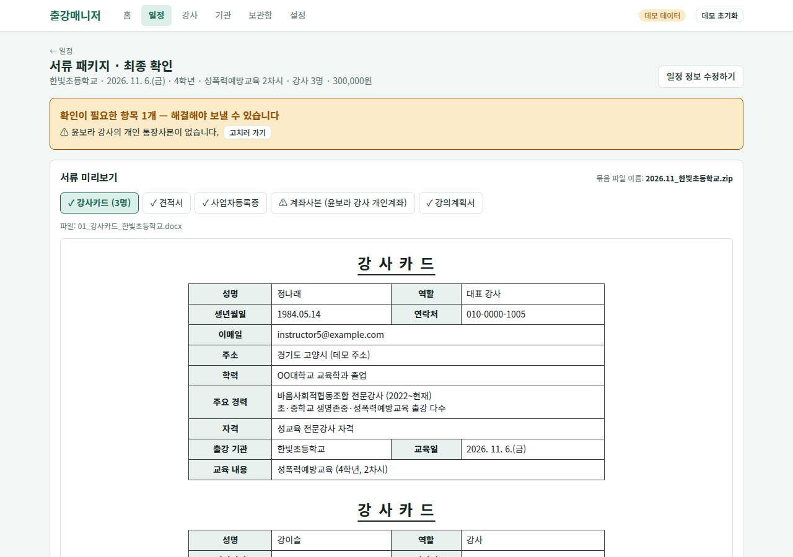

# 검증 결과

기획안의 검증 계획을 실제로 해 본 결과입니다. 데모 데이터(가짜 강사 14명, 기관 5곳, 출강 7건)로 했고, 1·2번은 브라우저 자동 테스트(Playwright)로 화면을 실제로 눌러 확인했습니다.

| # | 검증 | 결과 | 근거 |
|---|---|---|---|
| 1 | 서류가 빠짐없이 묶인다 | ✅ 통과 (2건 / 2건) | 아래 1 |
| 2 | 빠진 항목이 있으면 막고, 개인계좌 요청 건에는 해당 강사의 사본이 들어간다 | ✅ 통과 (4건 / 4건) | 아래 2 |
| 3 | 수락하면 zip이 첨부된 메일이 도착하고 발송 기록이 남는다 | ⏳ 진행 중 | 아래 3 |
| 4 | 서류 준비부터 발송까지 시간이 손으로 할 때의 절반 이하 | ⏳ 진행 중 | 아래 4 |

## 1. 서류가 빠짐없이 묶인다

방법: 서류 패키지 화면에서 확인 체크 → "수락하고 zip만 내려받기" → 내려받은 zip을 열어 파일 목록 확인

| 출강 | 강사 | 계좌 | zip 이름 | 안에 든 파일 |
|---|---|---|---|---|
| 가람초 11/4 | 4명 | 법인 | `2026.11_가람초등학교.zip` | 01_강사카드_가람초등학교.docx, 02_견적서_가람초등학교.docx, 03_사업자등록증.png, 04_계좌사본.png, 05_강의계획서_가람초등학교.docx |
| 한빛초 11/6 | 3명 | 개인(강이슬) | `2026.11_한빛초등학교.zip` | 01_강사카드_한빛초등학교.docx, 02_견적서_한빛초등학교.docx, 03_사업자등록증.png, 04_계좌사본.png, 05_강의계획서_한빛초등학교.docx |

- zip 이름이 `yyyy.mm_기관명.zip` 규칙과 맞음 (출강일 기준 월)
- 두 건 모두 5종이 다 들어 있음. 워드 파일 6개를 모두 열어 문서 구조(XML)가 정상인지 확인함
- 강사카드는 배정 인원만큼 쪽이 생김 (가람초 4쪽, 한빛초 3쪽)

## 2. 빠진 항목은 막고, 개인계좌는 맞는 강사의 사본을 넣는다

| 상황 | 기대 | 결과 |
|---|---|---|
| 푸른숲초: 담당자 이메일 없음 | 경고 + 수락 막힘 | "⚠ 받는 사람(기관 담당자) 이메일이 없습니다." 표시, 수락 버튼 비활성 |
| 다온초: 견적 단가 미입력 | 경고 + 수락 막힘 | "⚠ 견적 단가가 입력되지 않았습니다." 표시, 수락 버튼 비활성 |
| 한빛초: 개인계좌 요청, 강이슬 강사 | 강이슬의 통장사본이 들어감 | 계좌사본 탭이 "계좌사본 (강이슬 강사 개인계좌)", 미리보기에 강이슬 사본 |
| 한빛초: 개인계좌 강사를 통장사본이 없는 윤보라로 바꿈 | 경고 + 수락 막힘 | "⚠ 윤보라 강사의 개인 통장사본이 없습니다." 표시, 수락 버튼 비활성 |

추가로, 경고가 없어도 "모두 확인했습니다"에 체크하기 전에는 수락 버튼이 비활성인 것을 확인함 (2건).

## 3. 메일 발송

방법: 테스트 모드(`MAIL_TEST_RECIPIENT` = 내 메일)로 배포 주소에서 "수락하고 보내기" → 받은 편지함 확인 → 일정의 발송 이력 확인

결과: (Gmail 앱 비밀번호 설정 후 기록)

## 4. 시간 비교

방법: 같은 출강 1건을 (가) 기존 방식(파일 찾기, 양식 고치기, 모아서 메일 첨부)과 (나) 출강매니저로 준비해 각각 시간을 잼

| 방식 | 걸린 시간 |
|---|---|
| 기존 방식 | (기록) |
| 출강매니저 | (기록) |
